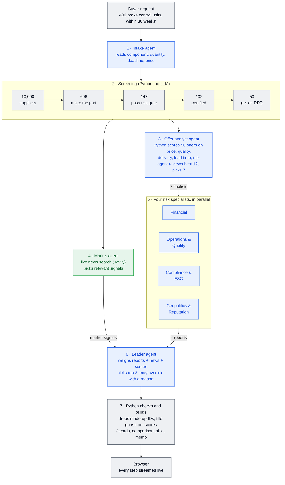

# RailRisk Radar

# 👉 [Live demo: railrisk-radar.onrender.com](https://railrisk-radar.onrender.com/)

### Login: username `jury` · password `Test12345`

*The free server sleeps when idle: the first visit can take up to a minute to load.*

---

Supplier selection and risk intelligence for rail procurement. Built for the **Siemens: Supplier Risk Intelligence** challenge at Nebius Build Week (Berlin, 18 Oct 2026).

A train is built from tens of thousands of parts. A buyer sourcing a component has to narrow thousands of candidate suppliers down to a few, compare them side by side and justify the final choice. RailRisk Radar does that over the challenge's 10,000-supplier dataset with a team of AI agents, answers questions in plain language grounded in the data, researches any real company on the web, and monitors real suppliers every day. All agents run on **NVIDIA Nemotron 3 Ultra** on Nebius Token Factory.

## What it does

| Page | What happens |
|---|---|
| **Find suppliers** | The buyer says what they are buying ("400 brake control units within 30 weeks"). Agents screen the 10,000 suppliers, send a request for quotation to the best 50, pick 7 finalists on price, quality, delivery and lead time, check them with four risk specialists and live market news, and **recommend 3** with offer, quality and risk facts, pros, cons and what to watch ([below](#find-suppliers-sourcing-agents)) |
| **Explore suppliers** | Start from *What are you buying?* (safety-critical, standard, budget part): the part type hides suppliers that fail its risk gate and picks the matching risk lens. Then filter by TRI, level, sourcing risk, complexity, delivery and confirmation rates, PO volume and knock-out rules, rank by the official TRI or a lens, and tick rows to shortlist them |
| **Compare shortlist** | Up to 20 suppliers side by side: ranking table, 18-score heatmap, TRI composition by risk family, risk-profile dot plot, head-to-head diff, and **price vs risk**: enter your quotes and get the best-value supplier for the part type |
| **Agent team** | A leader agent and four specialists decide on the shortlist live and end in a selection memo (download as .md) |
| **Supplier profile** | Exact explanation of any supplier's TRI (waterfall from the dataset average), percentile per score, operational metrics, and lower-risk alternatives with a similar profile |
| **Ask the data** | Chat assistant that calls tools over the dataset (filter, compare, explain, statistics). It picks its own charts to show under the answer and can add suppliers to the shortlist. The full tool trace is visible |
| **Research agent** | Name a real company. The agent plans its research, searches news and the web, reads the company's own site, **digs deeper on red flags**, closes evidence gaps, then scores the company on the dataset's 18 dimensions with a source link behind each finding. It computes a TRI with the dataset's formula, so you can see where a real company would rank among your 10,000 suppliers |
| **Live tracking** | Real suppliers watched every day: one worker agent per supplier searches recent news and extracts dated risk events, Python turns them into a daily risk series, trend and 30-day forecast, and a leader agent writes the portfolio briefing and watchlist |

## What we found in the data

- **Total_Risk_Index is an exact weighted sum** of the 18 scores. We recovered the weights by regression and verified them on all 10,000 rows: Operational Resilience, Financial Health and Quality 10% each; Compliance 8%; Credit Rating, Safety and Sub-Tier Visibility 6% each; Geopolitical, Governance and ESG 5% each; Environmental, Labor, Digital Security, Political Stability and Industry Benchmark 4% each; Market, Media and External Intelligence 3% each. Every "why is this TRI high?" answer is therefore exact, not a guess.
- Levels: Low < 25 ≤ Medium < 50 ≤ High < 75 ≤ Critical.
- The operational metrics are not part of the TRI. Delivery rating still correlates strongly with it (r = −0.71), which suggests the scores predict real delivery problems.
- Hard-to-replace suppliers (Sourcing Risk High) average TRI 61, versus 39 for easy-to-replace ones.
- The dataset has no country, category, component or price columns, so the assistant says so instead of guessing.

**Risk lenses** re-weight the same 18 scores for a sourcing situation: *Safety-critical component*, *Long-term strategic partner*, *ESG & compliance first*, *Non-critical part (budget)*, or *Custom* sliders. The official TRI stays visible everywhere.

**Part types** set how strict the search is. *Safety-critical* hides any supplier with High or Critical safety, quality or compliance risk or a High TRI, and price counts 10% against risk. *Standard* hides Critical TRI, safety or quality risk (price 40%). *Budget* hides only Critical TRI (price 70%).

## Find suppliers (sourcing agents)

A Python orchestrator runs a fixed pipeline of eight agents. Python computes every number; the agents shortlist, judge, read the news and decide. Agents that do not depend on each other run in parallel, and every agent answer is checked before it is used: unknown supplier IDs are dropped, gaps are filled from the score ranking, and a news link only counts if it came from the search results.



- **Offer score** (0–100, lower = better): price, risk (lens index), quality risk, delivery reliability and lead time, each scaled within the 50 offers. Price's weight comes from the part type; offers that miss the deadline rank last.
- **Final score**: half the offer score, half the four specialists' weighted area risk. The leader follows it unless a red flag or a market signal is a stated reason to change the order.
- The buyer gets three recommendation cards, the three side by side, the market signals with links, why the other four finalists lost, all 50 offers with their scores, and a memo. *Compare the 3* sends them to the shortlist with their offers as quotes.

**Simulated data.** The dataset is anonymized and has no product catalog or prices. Which suppliers make which of the 14 rail components, their certificates (IRIS, EN 15085-2, EN 45545-2, …) and their offers are simulated in `core/sourcing.py`: deterministic per supplier and component, so the same request always gets the same offers. Risk, quality, delivery and confirmation figures come from the dataset; market news is live.

## Agent team (multi-agent decision)

On the **Agent team** page, the buyer describes the purchase for the current shortlist:

1. A **leader agent** starts from the active risk lens and decides how much each risk area counts for this purchase (e.g. safety-critical pushes Operations & Quality up), then briefs four specialists.
2. Four **specialist agents** analyse the shortlist **in parallel**, each owning a slice of the 18 scores (every score exactly once): *Financial*, *Operations & Quality* (plus delivery, confirmation, order change, sourcing risk, complexity), *Compliance & ESG*, *Geopolitics & Reputation*. Each returns a pick, findings, red flags, and **designs its own chart** (kind + columns), which the app draws from the real dataset values.
3. The leader weighs the reports against an exactly computed **team score** (weighted area risk), resolves disagreements and writes the selection memo.

The UI streams all five agents live, then shows a flow diagram, team scorecard, score build-up, each agent's report and chart, and Nemotron's own reasoning per agent.

## How it works

```
supplier_risk_dataset.csv, risk_criteria_description.md   (challenge inputs)
   │
   ├── core/dataset.py    loading, exact TRI decomposition, filters, comparison, lenses, part types and risk gates
   ├── core/sourcing.py   Find suppliers: screen → 50 RFQs → offer analyst → specialists + market agent → leader picks 3
   ├── core/team.py       agent team: leader plan → 4 parallel specialists → leader verdict and memo
   ├── core/agent.py      tool-calling agent loop with visible trace; dataset tools + rail tools
   ├── core/workflows.py  research agent · rail news scan, scenarios, mitigation
   ├── core/tracking.py   live tracking: daily worker agent per supplier, risk series, forecast, leader briefing
   ├── core/llm.py        Nemotron 3 Ultra on Nebius Token Factory (hardcoded as MODEL_ID) + Tavily search
   └── core/model.py      rail extension: scoring + networkx supply graph + impact propagation (data/)
api/main.py               FastAPI: jury login, shared metadata, serves the React build
api/routes/               one router per page; agent runs stream to the browser as NDJSON
web/                      React + TypeScript + Tailwind + Recharts: left sidebar (pages, risk lens, shortlist)
evals/                    offline robustness tests and live chat evals against Nemotron
app.py, views/            previous Streamlit UI, kept as a fallback (includes the rail impact lab)
```

The model is always `nvidia/Nemotron-3-Ultra-550b-a55b` (`MODEL_ID` in `core/llm.py`); there is no provider or model switch.

## Run it

```bash
uv venv --python 3.12 .venv && uv pip install --python .venv/bin/python -r requirements.txt
cp .env.example .env   # NEBIUS_API_KEY + TAVILY_API_KEY; optional APP_USERS=jury:password
cd web && npm ci && npm run build && cd ..
.venv/bin/uvicorn api.main:app --port 8000   # open http://localhost:8000
```

For frontend work run `.venv/bin/uvicorn api.main:app --reload --port 8000` and `cd web && npm run dev` (Vite on :5173 proxies `/api`).

Filtering, comparison and profiles work without any keys. The agents need `NEBIUS_API_KEY`; the research agent, live tracking and the market check in Find suppliers also need `TAVILY_API_KEY`. Without an LLM key, Find suppliers still returns a recommendation from the scores alone.

**Tests.** `.venv/bin/python -m evals.test_agent_offline` and `.venv/bin/python -m evals.test_sourcing_offline` run with a fake LLM and cost no credits. `.venv/bin/python -m evals.chat_evals` runs the live chat evals (see `AGENTS.md`).

## Deploy

**Render.** The `Dockerfile` builds the frontend and serves everything from one container on `$PORT`; `render.yaml` is a ready blueprint. Set `NEBIUS_API_KEY`, `TAVILY_API_KEY` and `APP_USERS` in the dashboard. Render deploys `master`.

**Demo results.** The tracked seeds in `cache/demo/` (Find suppliers, agent team, research report, live tracking, memo, threats, scenario, response plan) fill every page on a fresh deployment. The last run of each agent page is saved on the server in `cache/last_<key>.json` (gitignored) and shown to everyone who opens that page, until the container restarts. `python prewarm.py` regenerates the seeds; `python prewarm.py --local` writes `cache/last_*.json` instead.

**Login.** `APP_USERS="jury:password,alice:other"` turns on a sign-in form. Without it the app is open.

**Docker.**

```bash
docker build -t railrisk-radar .
docker run --rm -p 8000:8000 --env-file .env railrisk-radar   # honours $PORT if the platform sets it
```

`.env`, `.streamlit/secrets.toml`, `.venv` and `.git` are kept out of the image by `.dockerignore`. Pass keys at runtime.

**Streamlit fallback.** Point Streamlit Community Cloud at `app.py` and paste the keys under *App settings → Secrets*, using [`.streamlit/secrets.toml.example`](.streamlit/secrets.toml.example) as the template.

## Data

The 10,000 suppliers are the challenge's anonymized dataset. Find suppliers adds a simulated product catalog, certificates and offers on top (see above). The rail impact lab (Streamlit fallback only) uses separate fictional suppliers, customers and KPIs (`data/`, regenerate with `python data/seed.py`); train product names are used for context only. News and research come from live web search.
